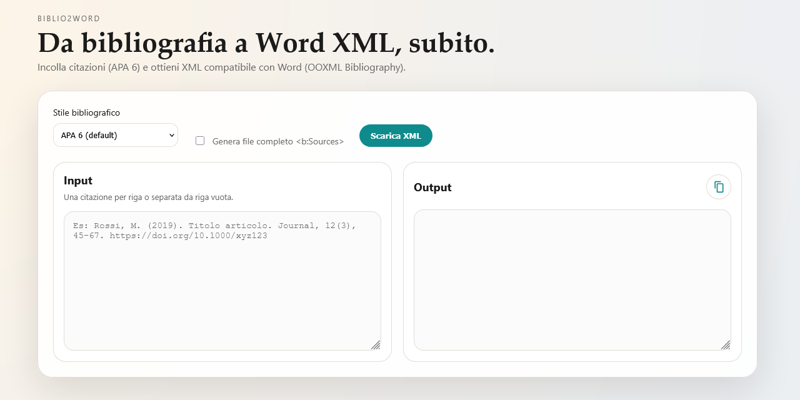

# biblio2word



A browser-based utility that converts bibliographic citations into **Microsoft Word Bibliography XML (OOXML)** using the Office bibliography schema.

Demo: https://silviotorre.github.io/biblio2word/

## Purpose

Microsoft Word stores bibliography sources in a structured XML format. This project provides a small conversion pipeline from human-readable citation text to Word-compatible bibliography sources, using **CSL-JSON** as the normalization layer.

```text
Citation text
  -> parser / normalization
  -> CSL-JSON
  -> Word bibliography mapping
  -> OOXML bibliography source(s)
```

## Supported styles

- APA 6 — default
- Chicago — beta
- Harvard — beta
- Vancouver — beta
- OSCOLA — beta

The beta parsers are intentionally heuristic. They cover common citation patterns but are not intended to represent every valid variation of each style.

## Output

The application can produce:

- individual `<b:Source>` nodes for direct reuse;
- a complete `<b:Sources>` document suitable for import into Word.

Schema namespace:

```text
http://schemas.openxmlformats.org/officeDocument/2006/bibliography
```

## Example input

APA 6:

```text
Rossi, M. (2019). Titolo articolo. Journal, 12(3), 45-67. https://doi.org/10.1000/xyz123
```

Vancouver:

```text
1. Rossi M, Bianchi L. Titolo articolo. Journal. 2019;12(3):45-67. doi:10.1000/xyz123
```

OSCOLA:

```text
Rossi, M, Titolo libro (Editore 2019)
```

## Implementation

- Vanilla JavaScript; no application framework.
- Modular parsers and normalization logic under `src/`.
- CSL-JSON used as the intermediate representation.
- Dedicated mapping from normalized CSL data to Word bibliography XML.
- Automated tests available through `npm test`.

## Project status

**Working utility / parser experiment.**

The project is useful both as a practical converter and as a compact example of format normalization, heuristic parsing, and transformation between bibliographic representations.
